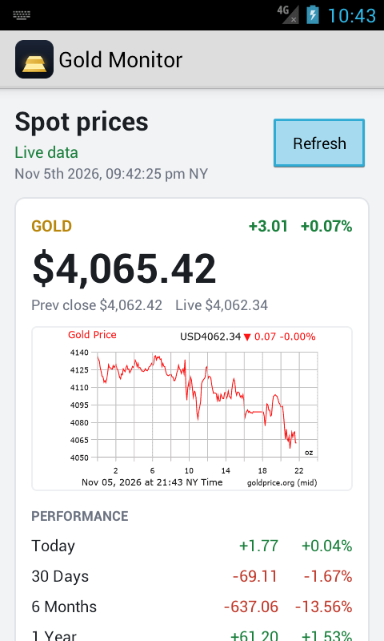
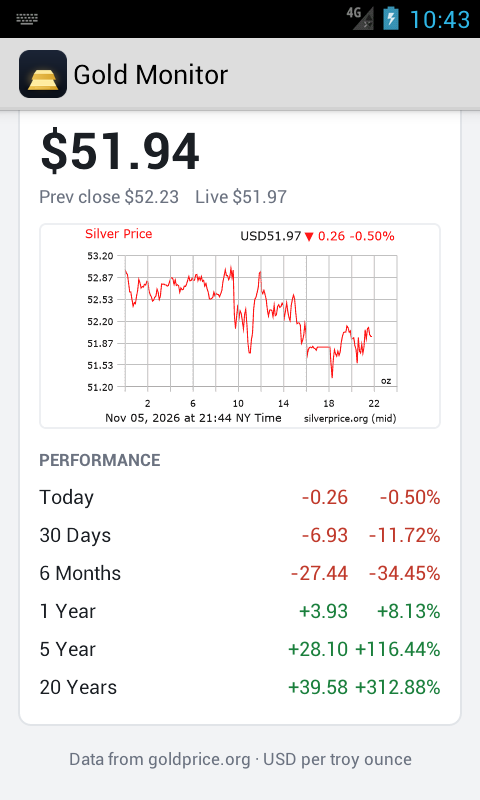
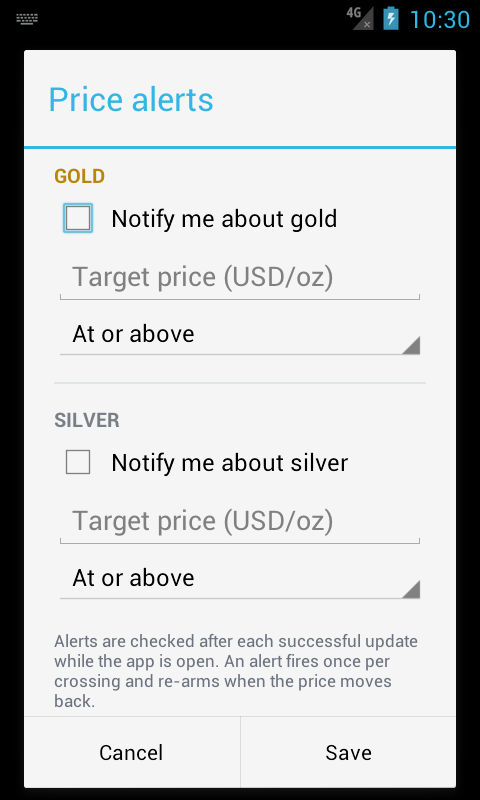
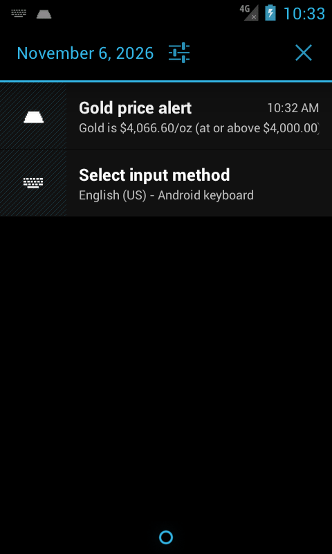

# Gold Monitor

A small Android app that shows live gold and silver spot prices, 24-hour charts and
price-performance figures from [goldprice.org](https://goldprice.org/).

It is built for **Android 4.0 (API 14) and newer** using only framework classes — no
AndroidX, no AppCompat, no Gradle dependencies. The APK is assembled directly with
`aapt2`, `javac`, `d8`, `zipalign` and `apksigner`.

 

## Features

- Gold and silver spot prices in USD per troy ounce, with daily change and percent change
- Previous close and latest live quote
- 24-hour gold and silver charts
- Performance table (today, 30 days, 6 months, 1 year, 5 years, 20 years)
- Automatic refresh while the screen is open (off / 10 s / 30 s / 1 min / 5 min / 15 min)
- Price alerts above or below a target, delivered as Android notifications
- Last-good data cached on disk; works offline and after a restart
- Holo Light UI that scales from small phones to tablets and rotates cleanly

## Screenshots

| Price alerts | Notification |
| --- | --- |
|  |  |

The screenshots above were taken on the Android 4.0.4 (API 15) emulator.

## Building

### Requirements

- JDK 8 (used for `javac`, `keytool` and the APK signature)
- Android SDK with:
  - `build-tools/36.0.0` (`aapt2`, `d8`, `zipalign`, `apksigner`)
  - `platforms/android-36/android.jar` (compile SDK)
  - `platform-tools/adb` (only needed for `install` / `run`)
- Python 3 with Pillow, only if you want to regenerate the icons

`build-tools/30.0.3` can compile the code but its `aapt2` cannot read the resource
table in the newer `android-36` platform jar, and its `d8` crashes on the Bouncy
Castle jars. The script therefore defaults to `build-tools/36.0.0`.

### Commands

```bash
export ANDROID_HOME=/path/to/Android/Sdk
export JAVA8_HOME=/path/to/jdk8       # defaults to /usr/lib/jvm/java-8-openjdk

./build.sh          # build/build/goldmonitor.apk
./build.sh install  # build and install on the connected device
./build.sh run      # build, install and launch
```

The first build creates a local signing key at `keys/goldmonitor.jks`
(alias `goldmonitor`, password `goldmonitor`). **Replace this key before publishing
the app.** Both APK Signature Scheme v1 (JAR signing, SHA-1 digests for API < 18) and
v2 are produced; Android 4.0 only understands v1.

Useful overrides: `BUILD_TOOLS`, `ANDROID_PLATFORM`, `ADB`, `AAPT2`.

## Why the TLS code is unusual

`data-asg.goldprice.org`, `charts.goldprice.org` and `goldprice.org` only accept
TLS 1.2. Android 4.0 ships TLS 1.0 only, so the platform HTTPS stack cannot connect
at all. The app uses two transports:

| Android version | Transport |
| --- | --- |
| API 14–20 | Bouncy Castle low-level TLS (`org.bouncycastle.tls`) plus a small HTTP/1.1 client |
| API 21+ | `HttpsURLConnection` with a socket factory that forces TLS 1.2 and RSA cipher suites |

The legacy transport deliberately avoids the Bouncy Castle JSSE provider: that
provider references Java 7 classes that do not exist on Android 4.0. It implements
just enough HTTP/1.1 for these endpoints — keep-alive, `Content-Length`, chunked
bodies, gzip, redirects and a single retry with a cache buster when the origin
returns an unexpected `304`.

Only RSA cipher suites are offered:

```
TLS_ECDHE_RSA_WITH_AES_128_GCM_SHA256
TLS_ECDHE_RSA_WITH_AES_256_GCM_SHA384
TLS_ECDHE_RSA_WITH_AES_128_CBC_SHA256
TLS_ECDHE_RSA_WITH_AES_128_CBC_SHA
```

That makes `charts.goldprice.org` serve its RSA/GTS certificate chain on every
Android version instead of switching to its ECDSA chain.

### Trust anchors

Android 4.0's system store predates the roots used by these hosts, so the APK
bundles four anchors in `assets/anchors/`:

- `isrg-root-x1.pem` — Let's Encrypt's root, used by the data and performance hosts
- `gts-root-r1.pem` — Google Trust Services R1 (self-signed)
- `gts-root-r1-cross.pem` — GTS R1 as cross-signed by GlobalSign (the form the
  chart host actually sends)
- `gts-root-r4.pem` — GTS R4 (ECDSA, kept as a fallback)

Validation first tries the platform trust store, then checks the chain against the
bundled anchors. The legacy path also performs its own hostname verification,
including SAN and single-label wildcard matching. Nothing disables certificate or
hostname checks.

### Required request headers

The hosts require `Referer: https://goldprice.org/`. The app also sends an empty
`User-Agent` and `Origin: https://goldprice.org/`; a browser-like User-Agent is
rejected with HTTP 403.

## Data sources

| Purpose | URL |
| --- | --- |
| Spot prices | `https://data-asg.goldprice.org/dbXRates/USD` |
| Live gold | `https://data-asg.goldprice.org/GetData/USD-XAU/1` |
| Live silver | `https://data-asg.goldprice.org/GetData/USD-XAG/1` |
| Gold chart | `https://charts.goldprice.org/charts/gold_1d_o_USD_z.png` |
| Silver chart | `https://charts.goldprice.org/charts/silver_1d_o_USD_z.png` |
| Gold performance | `https://goldprice.org/performance-json/gold-price-performance-USD.json` |
| Silver performance | `https://goldprice.org/performance-json/silver-price-performance-USD.json` |

## How it fits together

```
src/com/goldmonitor/
  MainActivity.java          screen, menus, auto-refresh, alerts dialog
  Format.java                price and percentage formatting
  Prefs.java                 refresh interval, alert settings, last-fetch time
  Alerts.java                threshold crossing checks
  Notifications.java         notification posting (all API levels)
  Notifications16.java       Notification.Builder.build() (API 16+)
  Notifications26.java       notification channel (API 26+)
  http/
    Http.java                transport facade, anchors, modern TLS factory
    LegacyHttps.java         HTTP/1.1 client over the legacy TLS connection
    LegacyTls.java           Bouncy Castle TLS 1.2 client
    ChainVerifier.java       chain, anchor and hostname verification
    HttpResponse.java        status/body/headers value object
  data/
    MarketRepository.java    fetch, parse, cache, partial-failure handling
    Spot.java                spot quote model
    Performance.java         performance table model
    Snapshot.java            everything needed for one screen render
    Cache.java               last-good file cache
assets/anchors/              bundled root certificates
res/                         layouts, strings, colours, menu, icons
tools/DesktopTest.java       desktop harness for the legacy transport
tools/make_icons.py          regenerates launcher and notification icons
```

Every source is fetched independently. If one fails, the repository falls back to
that source's cached copy and marks the screen as showing cached data. Only a fresh
spot download may trigger price alerts, so a stale quote cannot fire a notification.

## Behaviour notes

- Prices are quoted in **USD per troy ounce**.
- Auto-refresh runs only while the activity is resumed; the menu lets the user turn
  it off or choose 10 s / 30 s / 1 min / 5 min / 15 min. The default is 1 minute.
- Alerts fire once when the price crosses the target. They re-arm after the price
  moves back to the other side of the target.
- The cache lives in `getFilesDir()/market-cache` and survives restarts.
- The app asks only for `INTERNET` and `ACCESS_NETWORK_STATE`.

## Verification performed

- All seven endpoints fetched through the legacy Bouncy Castle transport on a
  desktop JVM and on the **Nexus_S_API_15** emulator (Android 4.0.4, Dalvik).
- Cold start, live refresh, manual refresh, cached fallback with HTTPS blocked,
  rotation between portrait and landscape, alert save and notification delivery all
  exercised on the emulator.
- APK verifies with `apksigner` v1 and v2 and installs successfully on Android 4.0.4.

## Limitations

- The app is USD-only.
- Refresh and price alerts only run while the app is open; there is no background
  service, widget or Wear support.
- The endpoints are public goldprice.org endpoints and may change without notice.
- Bouncy Castle adds roughly 4.4 MB of dex; the APK is about 1.7 MB after
  compression.
- The checked-in signing key is a development key, not suitable for distribution.

## License

The source is provided as-is for personal use. Gold and silver data belongs to
goldprice.org; respect their terms when using the endpoints.
